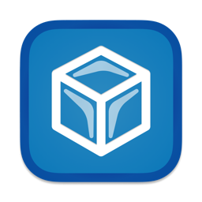

<div align="center">
    
    <h1>Trincano</h1>
</div>

Trincano is a menu bar manager for macOS, with a focus on Macs with a notch and on macOS 26 (Tahoe). It hides and shows menu bar items, shows them in a bar below the menu bar (the "Trincano Bar") and more.

> [!IMPORTANT]
> **Trincano is a modified version of [Ice](https://github.com/jordanbaird/Ice), by Jordan Baird.** It is free software released under the [GNU General Public License v3.0](LICENSE), like Ice. It is based on Ice's `macos-26` branch. Modified by Paulo Victor T Silva (PILUTECH), 2026. Many thanks to Jordan Baird and to everyone who contributed to Ice. This project is not affiliated with or endorsed by the Ice project.


[](LICENSE)

## Privacy

Everything stays on your Mac. Trincano has no telemetry, no analytics and **no network access**: it does not check for updates (the update system of Ice was removed). It needs two permissions to work: Accessibility and Screen Recording (used only to read the position and image of menu bar items).

## Build and install

Requires Xcode 26 and macOS 26. There are no prebuilt releases.

```sh
scripts/build.sh      # Release build, signed with a local certificate
scripts/install.sh    # copies to /Applications/Trincano.app (never closes Ice)
scripts/check.sh      # swiftlint + tests + build (everything runs locally)
```

The build is signed with a self-signed local certificate ("Trincano Local Signing", created on first build in `~/.trincano/signing`) so macOS remembers the permissions between builds. To sign with another identity (for example a Developer ID), set `SIGN_IDENTITY`. See [docs/assinatura.md](docs/assinatura.md).

Do not run Trincano and Ice at the same time: both manage the same menu bar.

## Documentation

See [docs/](docs/) (in Portuguese). Original features and roadmap from Ice follow.

## Features/Roadmap

### Menu bar item management

- [x] Hide menu bar items
- [x] "Always-hidden" menu bar section
- [x] Show hidden menu bar items when hovering over the menu bar
- [x] Show hidden menu bar items when an empty area in the menu bar is clicked
- [x] Show hidden menu bar items by scrolling or swiping in the menu bar
- [x] Automatically rehide menu bar items
- [x] Hide application menus when they overlap with shown menu bar items
- [x] Drag and drop interface to arrange individual menu bar items
- [x] Display hidden menu bar items in a separate bar (e.g. for MacBooks with the notch)
- [x] Search menu bar items
- [x] Menu bar item spacing (BETA)
- [ ] Profiles for menu bar layout
- [ ] Individual spacer items
- [ ] Menu bar item groups
- [ ] Show menu bar items when trigger conditions are met

### Menu bar appearance

- [x] Menu bar tint (solid and gradient)
- [x] Menu bar shadow
- [x] Menu bar border
- [x] Custom menu bar shapes (rounded and/or split)
- [ ] Remove background behind menu bar
- [ ] Rounded screen corners
- [ ] Different settings for light/dark mode

### Hotkeys

- [x] Toggle individual menu bar sections
- [x] Show the search panel
- [x] Enable/disable the Ice Bar
- [x] Show/hide section divider icons
- [x] Toggle application menus
- [ ] Enable/disable auto rehide
- [ ] Temporarily show individual menu bar items

### Other

- [x] Launch at login
- [x] Automatic updates
- [ ] Menu bar widgets

## Why does Ice only support macOS 14 and later?

Ice uses a number of system APIs that are available starting in macOS 14. As such, there are no plans to support earlier versions of macOS.

## Gallery

#### Show hidden menu bar items below the menu bar


#### Drag-and-drop interface to arrange menu bar items


#### Customize the menu bar's appearance


#### Menu bar item search


#### Custom menu bar item spacing


## License

Ice is available under the [GPL-3.0 license](LICENSE).
