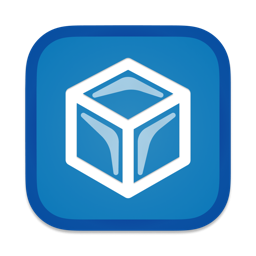
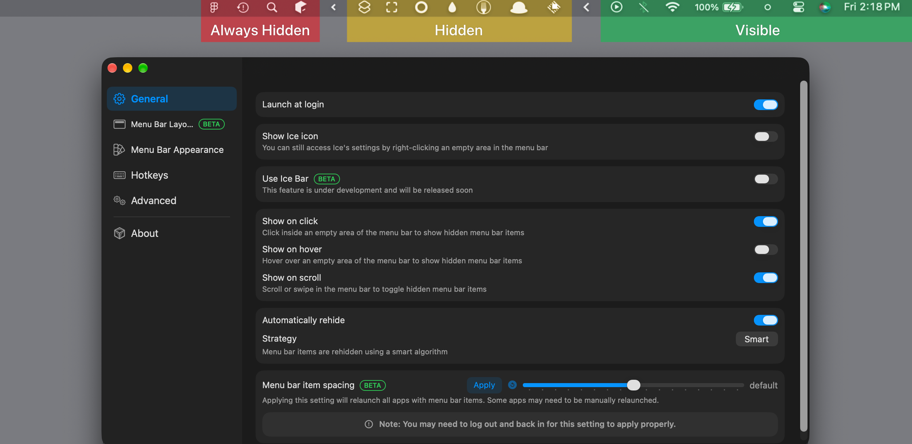
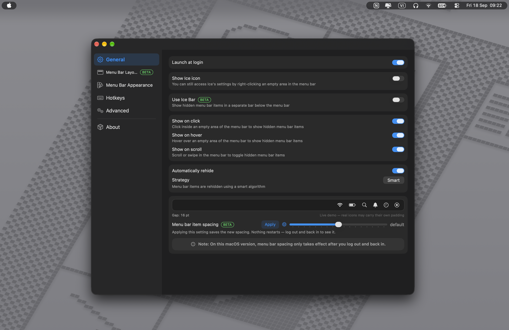
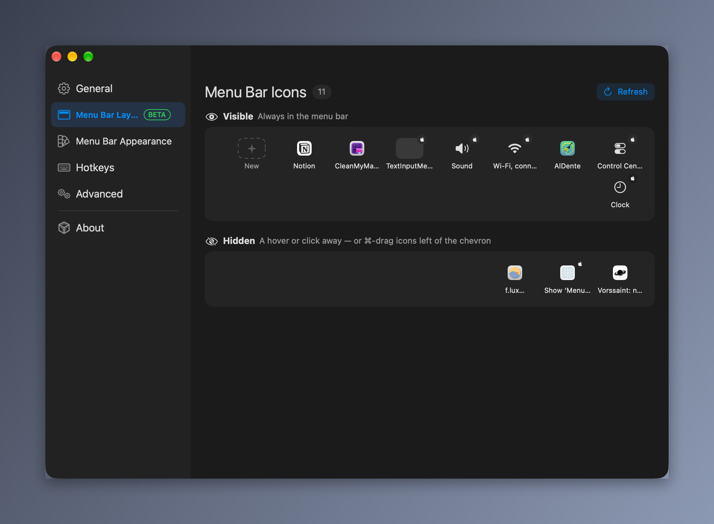
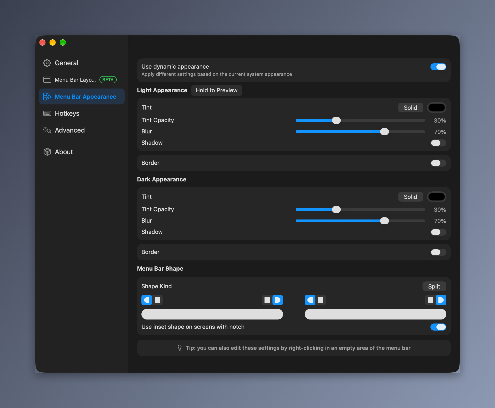

<div align="center">
    
    <h1>Ice — Free & Open-Source Menu Bar Manager for macOS</h1>
    <p>Hide and organize menu bar icons on your Mac. The best <strong>free Bartender alternative</strong> — also a great <strong>Hidden Bar</strong> and <strong>Vanilla alternative</strong> — focused on stability and a smooth, distraction-free experience.<br>✅ <strong>Fully supports macOS 27</strong></p>
</div>



<div align="center">

[](https://github.com/cavaldos/Ice/releases/latest)
[](https://github.com/cavaldos/Ice/releases)


[](https://github.com/cavaldos/Ice/stargazers)
[](https://github.com/cavaldos/Ice/network/members)
[](https://icemenubar.app)
[](LICENSE)
[](https://ko-fi.com/calvados)

<br>

<a href="https://ko-fi.com/calvados" target="_blank">
    
</a>

</div>

> [!NOTE]
> Ice is in active development. Grab the latest build from the [releases page](https://github.com/cavaldos/Ice/releases/latest).

> [!TIP]
> ✅ **Fully supports macOS 27** — tested and ready for the latest macOS, all the way back to macOS 14 Sonoma.

## Install

**Homebrew** (recommended — updates with `brew upgrade`):

```bash
brew tap cavaldos/tap
brew install cavaldos/tap/ice
```

**Manual:**

1. Download `Ice.zip` from the [latest release](https://github.com/cavaldos/Ice/releases/latest).
2. Unzip it and move `Ice.app` into `/Applications`.
3. Clear the quarantine flag — releases are ad-hoc signed and not notarized, so Gatekeeper would otherwise block the first launch:

```bash
xattr -d com.apple.quarantine /Applications/Ice.app
```

Then open Ice and grant **Accessibility** and **Screen Recording** in System Settings (see [Permissions](#permissions)).

For local development, see [script/README.md](script/README.md).

## Uninstall

**Homebrew:**

```bash
brew uninstall --cask cavaldos/tap/ice
```


```bash
brew uninstall --cask --zap cavaldos/tap/ice
```

**Manual:** quit Ice, then drag `Ice.app` out of `/Applications` to the Trash. To also remove preferences, delete `~/Library/Preferences/com.jordanbaird.Ice.plist`.


## Gallery

**Always-Hidden section demo — hide menu bar icons and reveal on hover**


**Show and hide menu bar icons demo**


**Fullscreen settings**




| Ice Bar — second menu bar for notched MacBooks                                                   | Drag-and-drop menu bar layout                                                                   |
| ------------------------------------------------------------------------------------------- | --------------------------------------------------------------------------------------------------- |
|  |  |

| Menu bar appearance and theme settings                                                                  | Menu bar item spacing                                                                                       |
| ------------------------------------------------------------------------------------------------------- | --------------------------------------------------------------------------------------------------------- |
|  |  |


> ✅ **macOS 27 fully supported** — works on macOS 14 Sonoma and later, including Sequoia, Tahoe, and macOS 27. If you need a similar tool for macOS 13 Ventura or earlier, check out [Ice 0.11.x](https://github.com/jordanbaird/Ice/releases).


## Contributing

Contributions are welcome! Please read the [contribution guidelines](./Resources/document/CONTRIBUTING.md) before submitting a pull request.

## Contributors

Thanks to everyone who has contributed to this fork:

<a href="https://github.com/cavaldos"></a>
<a href="https://github.com/pythongod"></a>
<a href="https://github.com/WuColin-1"></a>

## Support

<a href="https://ko-fi.com/calvados" target="_blank">
    
</a>

<a href="https://www.paypal.com/paypalme/nnkhanh29" target="_blank">
    
</a>

## Acknowledgments

A fork of [Ice](https://github.com/jordanbaird/Ice) by [Jordan Baird](https://github.com/jordanbaird) — huge thanks for the original work this project builds on.

## License

[GPL-3.0](LICENSE) — Ice is and will always remain open-source and free.

## Star History

<a href="https://star-history.com/#cavaldos/Ice&Date">
    
</a>
